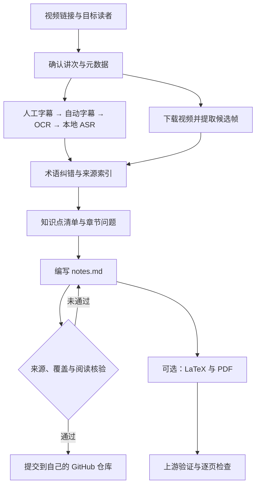

# 从视频到讲义：自动化全流程

## 1. 交付目标与边界

输入一条已经选定讲次的视频链接，输出一份中文 `notes.md`、与正文对应的配图，以及可回查的来源记录。可选的第二条输出线是完整 `notes.tex` 和经过编译核验的 `notes.pdf`。

参考项目原生面向 LaTeX / PDF。本流程补充 Markdown 作为仓库阅读入口，不宣称它与上游的 PDF 门禁等价。自动采集、格式检查可以交给脚本；讲解是否忠实、截图是否支持论点仍需要语义核对。



## 2. 一次任务先确定什么

记录课程、讲师、视频链接、分 P、目标读者、讲义语言、是否需要配图与 PDF，以及目标仓库。B 站合集和同一视频内的分 P 是两种结构，不能只凭“第 3 讲”推断 `p=3`。

本次示例是 `BV1kybV6DE47`，此前公开接口显示只有一个分 P，时长 6014 秒。复用流程处理其他视频时需要重新探测，不能照搬这些值。

先识别来源，再列出分 P：

```powershell
python .\vendor\lecture-to-notes\scripts\video_source.py detect '视频链接'
yt-dlp --flat-playlist --print '%(playlist_index)s\t%(title)s' '视频链接'
```

下载时明确指定选中的单讲。若需多讲，每讲使用独立目录，单独核验。

## 3. Windows 环境准备

推荐 Python 3.12 和 Git。当前 `prepare.ps1` 调用 `acquire_video.py`，FFmpeg 由 imageio-ffmpeg 提供，媒体信息由 PyAV 读取，不再依赖系统 PATH 中的 ffmpeg / ffprobe。以下 Windows 步骤对应当前实际运行的入口。

以下是安装步骤，本文档不会自动修改系统环境：

```powershell
python -m venv .venv
.\.venv\Scripts\python.exe -m pip install -r requirements-latex.txt -r requirements-video.txt
```

检查 Python 下载器与本地媒体依赖：

```powershell
.\.venv\Scripts\python.exe -m yt_dlp --version
.\.venv\Scripts\python.exe -c "import av, imageio_ffmpeg, sherpa_onnx; print(imageio_ffmpeg.get_ffmpeg_exe())"
git --version
```

需要阅读、安装并完整使用上游 Skill 时，先克隆固定版本，阅读其完整说明和相关 references，再执行它的安装与预检。上游 `install_skill.sh` 是 Bash 脚本，Windows 上应使用 Git Bash 或 WSL，不能直接当作 PowerShell 脚本运行。

```powershell
git clone https://github.com/ysyecust/lecture-to-notes.git vendor/lecture-to-notes
git -C vendor/lecture-to-notes checkout 880f11c53c3abf65d01a643d895e04e56344b06f
```

在 Git Bash 中进入该上游目录后，可按上游说明运行 `bash scripts/install_skill.sh --codex`。安装后要核对复制的辅助脚本，而不只是检查 `SKILL.md` 是否存在。本流程文档本身不代表已经完成安装。

## 4. 采集视频、字幕与元数据

在本项目目录运行：

```powershell
.\prepare.ps1 -Url 'https://www.bilibili.com/video/BV1kybV6DE47/?p=1' -LectureId 'nju-gse-03-verified' -Python .\.venv\Scripts\python.exe
```

脚本保存原始元数据、视频和音轨，尝试下载字幕，用 PyAV 记录时长与媒体哈希，并每 15 秒抽取候选画面。已经完成的媒体与抽帧可以复用，阶段失败会停止并保留已完成产物。不同视频必须使用不同工作目录，统一入口还会检查 URL 是否对应。

如果需要已有浏览器登录态，可显式传入浏览器名称：

```powershell
.\prepare.ps1 -Url '视频链接' -LectureId '唯一的新目录名' -Browser chrome
```

浏览器名必须对应本机可读取的浏览器配置。当前对话内嵌浏览器的登录态不保证可被 `yt-dlp --cookies-from-browser` 读取。无法读取时，应改用可用浏览器、用户提供的媒体或字幕文件；不要把账号 Cookies 写进仓库。

`metadata.json` 可能带有临时媒体地址，适合保存在被忽略的工作目录；公开发布时只保留标题、课程链接、作者、时长和来源方式等必要字段。

## 5. 字幕回退与纠错

按成本和信息质量依次尝试：人工字幕、平台自动字幕、画面烧录字幕 OCR、本地 ASR。纯视觉只能支持画面中可见的内容，缺失口述时不能生成一份自称完整的课程讲义。

下载阶段同时请求人工和自动字幕，只是收集候选轨道。随后必须明确选定一条：

1. 列出 `work/<lecture-id>/` 中的 `.srt` 文件，检查语言和来源。
2. 对照开头、中间、结尾的音频或画面，检查错轨、漏段和术语。
3. 保留选中轨道的原文件名，并复制为 `audio.srt`。
4. 修改后的轨道另存为 `audio_corrected.srt`，记录修改依据。

上游的结构检查可作为辅助；讲座中有长时间静默时，覆盖率阈值需要结合内容解释，不能只为通过而删除失败信息。

```powershell
python .\vendor\lecture-to-notes\scripts\check_srt_health.py .\work\nju-gse-03\audio.srt --duration 6014
```

没有字幕时，当前已实测的入口是 `download_sensevoice.py` 和 `transcribe_sensevoice.py`，完整命令见 END_TO_END.md。它在本地处理音轨，不上传音频，SRT 时间标识真实的 20 秒输入窗口，保留未校对原文。Whisper 是可选的其他后端；不要仅为得到一个“字幕文件”而把粗粒度时间戳包装为逐字对齐。

公开整理稿可作辅助来源，但必须保留整理者、原视频、校对状态和许可。没有时间戳的 Markdown 整理稿不能改名伪装成 SRT，不能据此虚构精确视频时间。

## 6. 画面选择与证据记录

候选帧只是抽样，不能保证覆盖短暂出现的代码或幻灯片。先浏览缩略图定位关键内容，再打开原尺寸画面确认。字幕提到关键图表但候选帧没捕捉到时，回到相关时间补抽帧。

对于本次视频这类“讲者 + 课件”并排画面，先测量分栏，再仅保留有教学信息的一栏，避免字太小。叠加层裁剪、分栏和评分可使用上游 `frame_filter.py`；所有坐标都必须来自实测。

```powershell
python .\vendor\lecture-to-notes\scripts\frame_filter.py --help
```

每张实际采用的图片都记录在 `figure_manifest.tsv`：

```tsv
figure	frame	start	end	topic	panel
```

上面只给出表头，不填假数据。每行需要包含图片名、原始帧、真实时间区间、支持的知识点与裁剪区域。核验时同时看原图、对应字幕和正文描述；图片清晰不等于描述正确。

Markdown 中使用仓库相对路径，方便 GitHub 渲染：

```markdown


图：Git 对象关系。来源：原视频已核实的时间区间；附对应跳转链接。
```

只有图片真实存在、时间已经核实，才把示例替换为实际引用。

## 7. 先建立知识点与来源索引

先回答“读者学完能解释什么”，再拟章节，不按口头重复机械切段。

建立 `teaching_atoms.tsv`：

```tsv
atom	status	evidence
Git 快照与目录关系	pending	待绑定字幕时间或来源段落
暂存区和工作区的区别	pending	待绑定字幕时间或来源段落
小步提交与问题定位	pending	待绑定字幕时间或来源段落
```

`pending` 只有在讲义中存在完整解释并且来源可回查后才改成 `covered`。官方讲义提供的拓展材料与视频实际口述不完全相同，应注明“参考资料补充”。

另建 `numerical_claims.tsv`，追踪真正影响结论的数量、单位、参数和比较条件。转录中的日期、模型版本和讲师个人观察不要改写成无条件事实。发现冲突时保留疑点，回查原声或画面。

## 8. 讲义写作要求

每章回答一个问题，用完整段落解释：问题为什么出现、机制如何工作、例子怎样说明它、什么时候不适用。代码和命令要解释输入与后果；公式要紧跟符号说明；有意义的对比用表格。

正文建议结构：

```text
# 课程与讲次
## 学习目标
## 为什么需要这个概念
## 核心机制
## 操作示例与推导
## 常见误区和适用边界
## 小结与练习
## 来源与许可
```

结构按课程内容调整，不机械凑章数和字数。课程中的玩笑、重复和设备故障通常删去；有助于理解的案例保留其推理。编辑新增的例子明确标记，不能冒充讲师演示。

可直接复用 [TASK.md](TASK.md) 作为 Agent 的任务书。

## 9. Markdown 交付核验

自动检查：

```powershell
python .\validate_markdown.py .\notes\software-repository-management.md
```

该检查只判断文件结构、围栏是否配对、基本来源信息与本地引用是否存在。它不会证明课程知识正确，也不会冒充上游 `verify_notes.py` 的 `OVERALL PASS`。

发布前人工或 Agent 还需逐项检查：

- 关键知识点是否都有解释，是否遗漏机制、例子和重要条件。
- 每个关键数字、截图和归因是否能回到证据。
- 是否混淆视频口述、官方讲义补充和编辑解释。
- Markdown 预览中的标题、代码、表格、图片是否可读。
- 文件中是否残留 Cookies、Token、本地私人路径或临时下载地址。
- 来源与许可是否符合原课程、字幕和图片的条件。

按 3–5 分钟窗口做时间轴覆盖检查，是有完整 SRT 和视频时的后续核验。只有公开整理稿的交付必须如实标注证据限制。

## 10. PDF 输出分支

本项目默认采用 **Markdown → Pandoc → LaTeX（ctexart）→ PDF**，本地使用 Tectonic，云端使用 XeLaTeX。运行 `build_pdf.ps1` 导出，字体和部署说明见 [LATEX.md](LATEX.md)。截图与出处说明保持在同一版面块中；源证据检查和版式检查分别报告。

下面保留上游的 LaTeX 路线，供有公式和更复杂版式的课程使用。

需要完整复现参考项目时，继续用其完整 Skill 编写 `notes.tex`，准备它要求的原始视频、最终 SRT、几何记录、配图清单、知识点和数字核对表。不要直接把本 Markdown 示例标为通过其生产门禁。

安装 XeLaTeX、中文宏包、ImageMagick 和 Poppler 后，在单讲工作目录执行两次编译：

```powershell
xelatex -interaction=nonstopmode -halt-on-error notes.tex
xelatex -interaction=nonstopmode -halt-on-error notes.tex
```

MiKTeX 缺包时按其包管理配置处理；可参考上游说明使用 `-enable-installer`。编译成功后运行上游 `verify_figures.py`、`extract_claims.py` 和 `verify_notes.py`，其参数通过对应 `--help` 与固定版本说明核实。

```powershell
python <上游仓库绝对路径>\scripts\verify_notes.py --workdir <单讲工作目录绝对路径>
```

同时逐页检查 PDF 的中文断行、公式、表格、裁图及图注。自动报告通过不能替代视觉检查；有失败就修订并重新编译。Markdown 通过与 PDF 通过分别记录。

## 11. GitHub 上传

目标是用户自己的仓库；参考的 `ysyecust/lecture-to-notes` 只是来源，不能据此推断上传目标。先取得真实仓库链接与写入方式，再操作。

推荐公开提交文档、精选配图、必要的来源与核验记录。原视频、模型、环境、Cookies、临时地址和大批候选帧留在被忽略的工作目录。若要将本目录作为独立仓库，可采用下列忽略规则；不要覆盖已有仓库规则。

```gitignore
.venv/
work/
vendor/
reference/
__pycache__/
*.pyc
*.cookies.txt
```

在目标仓库已克隆、鉴权已可用的前提下，把文件放到约定目录，再显式暂存本次文件。以下命令中的占位路径需要替换，不能原样执行：

```powershell
git switch -c codex/lecture-notes-workflow
git add README.md WORKFLOW.md TASK.md prepare.ps1 validate_markdown.py notes/software-repository-management.md
git diff --cached --check
git diff --cached --stat
git diff --cached
git commit -m 'docs: add lecture notes workflow and repository management example'
git push -u origin codex/lecture-notes-workflow
```

仓库若已有同名文件，先比较并整合，不直接覆盖。若用户要求提交 PR，在已有 GitHub CLI 或连接工具可用时创建 PR，返回真实链接；分支推送不等于已经合入默认分支。也可以在已登录的 GitHub 网页上传指定 Markdown 文件，提交前检查目标分支和文件预览。

## 12. 本次实际状态与后续入口

已完成：参考资料阅读、上游版本和 CLI 参数核对、本流程文档、采集脚本、Markdown 基础检查器、课程示例讲义。

视频来源核验与 PDF 更新：本节课完整音视频、401 张候选帧、本地窗口字幕、12 张配图和逐 5 分钟主题覆盖记录由当前流程生成并审查。具体结果以 `evidence/source-verification.json` 和 PDF 检查报告为准。未执行的是上游 LaTeX 生产门禁；本项目不将自己的 PASS 冒充上游 PASS，也不声称逐字或逐帧全检。用户指定的上传目标为 https://github.com/zettarnc/- 。

常见阻塞：B 站 412 或无字幕先查提取器版本与登录态；Python 安装报代理错误先修网络；浏览器已登录但下载器不可用时检查是否同一浏览器配置；没有可用字幕也没有 ASR 时明确停止完整讲义验收，不用网页摘要顶替原视频证据。

## 参考

- [课程资料页面](https://blog.simona.plus/lecture-to-notes/)
- [上游固定版本 README](https://github.com/ysyecust/lecture-to-notes/blob/880f11c53c3abf65d01a643d895e04e56344b06f/README.md)
- [上游完整 Skill](https://github.com/ysyecust/lecture-to-notes/blob/880f11c53c3abf65d01a643d895e04e56344b06f/skills/lecture-to-notes/SKILL.md)
- [原课程官方讲义](https://jyywiki.cn/GSE/2026/lect3.md)
